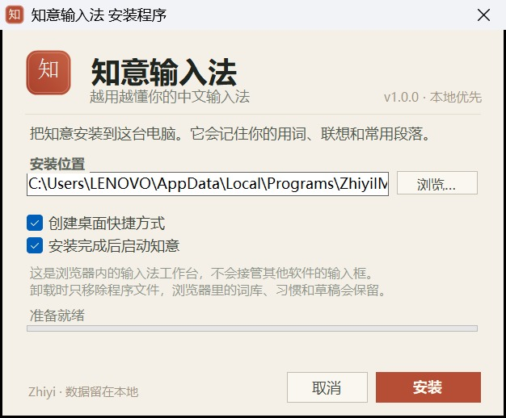

# 知意 · 中文输入法

> 把想说的话，轻轻写下来。  
> 一个会记住用词、会联想、能收藏常用段落的本地中文输入法工作台。

> **当前发布：`v1.0.0-beta.1` 开发者预览（无签名）**  
> 公开源码、MIT；安装包未签名，SmartScreen 可能提示。使用 Rime 方案前需先安装小狼毫。  
> 反馈问卷 / Issue 入口见 [FEEDBACK.md](FEEDBACK.md) 和 [RELEASE.md](RELEASE.md)。


## 它是什么

知意是一个**完全本地运行**的中文输入法实验：在一个安静的写作界面里，输入拼音、选择候选、积累习惯。它把「输入法」拆成三件可感知的事：

- **记得住**：你选过的词会逐渐排到候选前面；常用词对会形成下一句联想。
- **打得快**：词、成语和常用短句支持首字母联想，例如 `zg` → 中国、`nhm` → 你好吗。
- **叫得出**：收件地址、开票信息、邮件落款可以存成常用段落，用 `dz`、`kp` 这样的触发码一键调出。
- **调得动**：候选数量、主题、字号、中文标点、自定义词，以及导出 / 导入，都在设置里。

所有数据保存在本机浏览器中，没有远程服务器、没有账号、不上传文字。

> 说明：这是一个**浏览器内的输入法工作台**，不是 Windows 系统级 TSF 输入法。它提供完整的中文候选、记忆与段落体验；如果要接管系统里所有输入框，需要在此基础上接入 TSF / WPF / Electron 的全局键盘层。详见文末「边界与下一步」。

## 30 秒上手

1. 双击 **`启动知意输入法.cmd`**。  
   它会在 `127.0.0.1:8765` 启动一个只监听本机的静态服务，并用 Edge 的应用窗口打开知意。
2. 在写作区输入 `nihao`，按 **空格** 上屏「你好」。
3. 输入 `dz`，按空格调出「收件地址」。
4. 试试选中一个候选词，再从「常用段落」里插入一段文字；打开「习惯」看看它记住了什么。
5. 想关闭后台服务时，双击 **`停止知意输入法.cmd`**。

如果你只想快速看一眼，也可以直接用浏览器打开 `index.html`；但推荐使用启动脚本，`http://127.0.0.1:8765` 这个固定来源能保证本地数据稳定留存。

## 安装包

安装包不提交到 Git 仓库，请到 **GitHub Releases** 下载：

- [GitHub Releases](https://github.com/buddywong/zhiyi-ime/releases)
- 也可以在仓库的 `release/` 目录本地预览；正式发布时上传到 Releases。

| 文件 | 适合谁 | 说明 |
| --- | --- | --- |
| `知意输入法-1.0.0-beta.1-Setup.exe` | 想正常安装 | 安装到 `%LOCALAPPDATA%\Programs\ZhiyiIME`，创建桌面 / 开始菜单快捷方式与卸载入口 |
| `知意输入法-1.0.0-beta.1-Portable.zip` | 想解压即用 | 解压到任意目录，双击 `Zhiyi.exe`（或 `启动知意输入法.cmd`）即可 |



- 安装程序是**用户级安装**，不需要管理员权限。
- 桌面会生成「知意输入法」，开始菜单里还有「停止知意输入法」和「卸载知意输入法」。
- 卸载只移除程序文件；浏览器里的词库、习惯、草稿与常用段落会保留。要彻底清除，请在浏览器里删除 `127.0.0.1:8765` 的站点数据。
- 安装包**没有数字签名**。如果 Windows SmartScreen 提示，请选择「更多信息 → 仍要运行」。
- Release 附件里的 `SHA256SUMS.txt` 提供所有发布包的 SHA-256，可自行校验。

## Rime 系统级适配

如果希望知意**真正接管系统输入**，请使用 Rime 适配包：

**`知意输入法-1.0.0-beta.1-Rime.zip`**（在 GitHub Releases 下载）

使用前需要先安装 **小狼毫 Weasel**（Rime 的 Windows 前端）：<https://rime.im/download/>

1. 解压 ZIP。
2. 确认任务栏已有小狼毫图标。
3. 双击 `安装到小狼毫.cmd`。
4. 右键小狼毫图标 →「重新部署」。
5. 按 `F4` 或 ``Ctrl + ` ``，选择「知意拼音」。

适配内容：

- 约 11,700 条知意词条，支持全拼与简拼；
- 启用 Rime 用户词典，选词会被记住并逐渐提前；
- `dz`、`kp`、`lk`、`hy`、`qj`、`jj`、`xk` 触发内置常用段落；
- 词、成语和常用短句支持首字母输入：`zg` → 中国、`nhm` → 你好吗、`mgx` → 没关系；
- 首次安装时启用「知意纸白」小狼毫主题。

需要了解的差异：

- 候选窗与设置界面由小狼毫提供，不再是知意网页；
- 浏览器的习惯与自定义段落不会自动迁移，Rime 会从零开始学习；自定义段落可重新生成 Lua（见 [rime-package/README-Rime.md](rime-package/README-Rime.md)）；
- 浏览器版的二元组“下一句联想”没有完全等价物，Rime 版主要依赖用户词典与句子组合；
- 在网页「常用段落」页修改后，点 **「同步到小狼毫」**，知意会把最新段落写入 Rime 的 Lua 并自动重新部署；
- 也可以在「设置 → 输入」里开启 **「段落后自动同步」**，以后新增、修改或删除段落时自动写入小狼毫；
- 常用段落页和设置数据区会显示小狼毫连接状态。首次使用需要先通过启动脚本运行知意，浏览器直接打开 `file://` 时无法同步。

详细说明、故障排查和卸载方式见 [rime-package/README-Rime.md](rime-package/README-Rime.md)。

## 界面

| 输入 | 常用段落 |
| --- | --- |
|  |  |

| 习惯 | 墨夜主题 |
| --- | --- |
|  |  |

手机宽度下，导航会收成一行，候选窗变成底部浮层：


## 功能

### 1. 拼音候选

- 全拼输入；支持简拼（如 `bj` → 北京）和部分多音组合。
- 词库包含现代常用词、办公/地址/开票词汇，以及约 5,000 条词组。
- 单字按常用字频排序；词优先于字；完全匹配优先于前缀匹配。
- 候选数量可在 5–9 之间调整。

### 2. 习惯记忆

每次上屏一个词，知意会记录：

- 该词的使用次数与最近使用时间；
- 上一个词到当前词的二元组（用于下一句联想）。

候选排序会把「使用次数 × 时间衰减」叠加到基础词频上。连续用过几次的词，下一次会更靠前——在验收测试中，连续选择三次「你好吗」后，再输入 `nihao`，它已经排在「你好」前面。

### 3. 联想

上屏后，候选条下方会出现「联想」：

- 优先使用你形成的词对习惯；
- 没有个人记录时，用内置的常见搭配作为起点；
- 如果上下文出现「地址 / 发票 / 会议」等词，会优先提示相关常用段落；
- 按 **Tab** 采纳第一条联想。

### 4. 常用段落

- 内置 7 个示例：收件地址、开票信息、邮件落款、会议邀请、请假说明、个人简介、收到回复。
- 每条段落有标题、分类、触发码、内容，可新建、编辑、删除、固定到首页。
- 在输入框里直接输入触发码即可调出，例如 `dz`；匹配时会优先于普通候选。
- 分类：地址、开票、沟通、自定义。

### 5. 自定义词

内置词库没有的词，可以在「设置 → 自定义词」里添加：

- 词语：1–12 个汉字；
- 拼音：字母和空格，例如 `zhi yi`；
- 添加后立即进入候选池，并以较高权重参与排序。

### 6. 设置与数据

- 候选词数量、习惯学习、智能联想、中文标点、段落提示；
- 纸白 / 墨夜主题，15–24px 正文字号；
- 导出 JSON 备份、导入备份、恢复默认、只清空学习记录；
- 中文 / 英文模式，中文标点自动转换。

## 快捷键

| 按键 | 作用 |
| --- | --- |
| `Shift` | 中 / 英切换（单按松开，不配合其他键） |
| `空格` | 上屏当前高亮候选；无候选时上屏原始拼音 |
| `1`–`9` | 选择对应候选 |
| `←` / `→` | 在候选之间移动 |
| `Tab` | 输入中：上屏当前候选；输入后：采纳第一条联想 |
| `Enter` | 上屏当前候选；无候选时上屏原始拼音 |
| `Esc` | 取消当前拼音输入 / 关闭弹窗 |
| `Ctrl` + `1`–`4` | 切换到输入 / 常用段落 / 习惯 / 设置 |
| `Ctrl` + `Enter` | 在段落编辑框内保存 |

## 项目结构

```
zhiyi-ime/
├─ index.html                  页面骨架与 SVG 图标
├─ assets/
│  ├─ style.css                纸墨视觉、响应式布局
│  ├─ app.js                   编辑器、IME、学习、段落、设置
│  ├─ engine.js                候选与联想引擎（纯函数）
│  ├─ data.js                  构建生成的词库（约 1.18 万条候选）
│  ├─ snippets.js              内置常用段落
│  ├─ seeds.js                 初始联想搭配
│  └─ favicon.svg
├─ tools/
│  ├─ build-dict.mjs           词库构建脚本
│  └─ source/                  原始字音、词组与人工词表
├─ installer/
│  ├─ src/                     安装器 / 启动器 C# 源码
│  ├─ build.ps1                一键构建 Windows 安装包与便携版
│  └─ build-rime-package.ps1   打包 Rime 适配包
├─ rime/                       Rime schema、词库、Lua 段落
├─ rime-package/               Rime 安装/卸载脚本与说明
├─ dist/                       Setup.exe、Portable.zip、Rime.zip、SHA256SUMS
├─ preview/                    界面与安装程序预览图
├─ server.ps1                  仅监听 127.0.0.1 的静态服务器
├─ stop.ps1                    停止服务器
├─ 启动知意输入法.cmd
└─ 停止知意输入法.cmd
```

## 词库构建

`assets/data.js` 是生成文件，不要手工修改。重建：

```bash
node tools/build-dict.mjs
```

构建逻辑：

1. 从 `kHanyuPinlu.txt` 读取常用字及其多音读音；
2. 用 `kMandarin_8105.txt` 补充字表；
3. 从 `phrases.txt` 读取词组与权威拼音；
4. 合并 `curated.txt`（现代常用词）和 `overrides.txt`（多音词人工校正）；
5. 为人工词生成多音组合，按常用读音顺序降权；
6. 用词频与常用字顺序计算单字权重；
7. 输出 `entries`（词 + 字）、`syllables`（切分用音节表）与统计信息。

排序核心在 `assets/engine.js`：

```text
最终分 = 基础词频 × 完全匹配/前缀系数 × 习惯加成 × 上下文加成
习惯加成 = 1 + min(4.8, ln(1+次数) × 1.38) × 时间衰减
```

## 构建安装包

安装包由 Windows 自带的 .NET Framework 编译器构建，不需要联网或安装 Inno Setup / NSIS：

```powershell
powershell -ExecutionPolicy Bypass -File installer/build.ps1
```

输出在 `dist/`：

- `知意输入法-1.0.0-Setup.exe`：内嵌运行文件的自解压安装器
- `知意输入法-1.0.0-Portable.zip`：便携版
- `SHA256SUMS.txt`：SHA-256 校验

安装器源码在 `installer/src/Installer.cs`，启动器在 `installer/src/Launcher.cs`。安装器以当前用户权限运行，不请求管理员提权。

Rime 适配包：

```bash
node tools/build-rime.mjs
powershell -ExecutionPolicy Bypass -File installer/build-rime-package.ps1
```

`build-rime.mjs` 会从 `assets/data.js` 生成 `rime/zhiyi.dict.yaml` 与 `rime/lua/zhiyi_snippets.lua`；要带上浏览器里的自定义段落，可加参数 `--snippets=你的备份.json`。

## 数据与隐私

- 数据键：`localStorage["zhiyi.state.v1"]`。
- 包含：设置、草稿、已学词/词对、每日输入统计、常用段落、自定义词。
- 不包含：账号、设备标识、任何网络上报。
- 导出备份会生成一个 JSON 文件；导入会覆盖当前数据，导入前会二次确认。
- 删除浏览器站点数据会一并删除知意数据；请先导出备份。

## 边界与下一步

- **浏览器版知意**：一个可感知的输入法工作台，不能接管其他软件的键盘。适合体验完整交互、习惯图表和段落管理。
- **Rime 版知意**：通过小狼毫真正接管系统输入，复用词库、简拼、段落和 Rime 用户词典；候选窗是 Rime 的。
- **尚未具备**：完全保留知意 UI 和二元组联想的系统级 TSF 原生输入法；云同步；跨设备习惯同步。

如果要做“完全自己的”系统输入法，仍然建议走 TSF：

1. 用 **TSF（Text Services Framework）** 编写 COM 输入法，接管系统输入上下文；
2. 复用 `engine.js` 的候选、学习和段落模型，把数据层移到本地 SQLite / JSON；
3. 用 WPF / WinUI 做候选窗与设置面板，或把现有页面放进 WebView2；
4. 增加词库导入、用户词典同步、候选窗跟随光标等系统级细节。

## 发布与反馈

- 发布节奏、平台优先级和所需资质见 [RELEASE.md](RELEASE.md)；
- 隐私说明见 [PRIVACY.md](PRIVACY.md)；
- 版本变更见 [CHANGELOG.md](CHANGELOG.md)；
- 问题反馈请使用仓库 Issues，并先移除地址、电话、税号等敏感信息。

当前安装包**没有数字签名**，适合作为开发者预览 / Beta 发布；正式公开下载前建议先做代码签名。

## 数据来源与许可

本项目代码以 MIT 许可发布，详见 `LICENSE`。词库构建使用的上游数据：

- [mozillazg/pinyin-data](https://github.com/mozillazg/pinyin-data) 的 `kHanyuPinlu.txt`、`kMandarin_8105.txt`（Unihan / Unicode 数据）；
- [mozillazg/phrase-pinyin-data](https://github.com/mozillazg/phrase-pinyin-data) 的 `pinyin.txt`（MIT）；
- 本项目补充的 `curated.txt`、`overrides.txt`、`topchars.txt`。

具体版本与许可见 `NOTICE.md` 和 `tools/source/README.md`。

---

知意 · 写你所想。数据留在本地。
